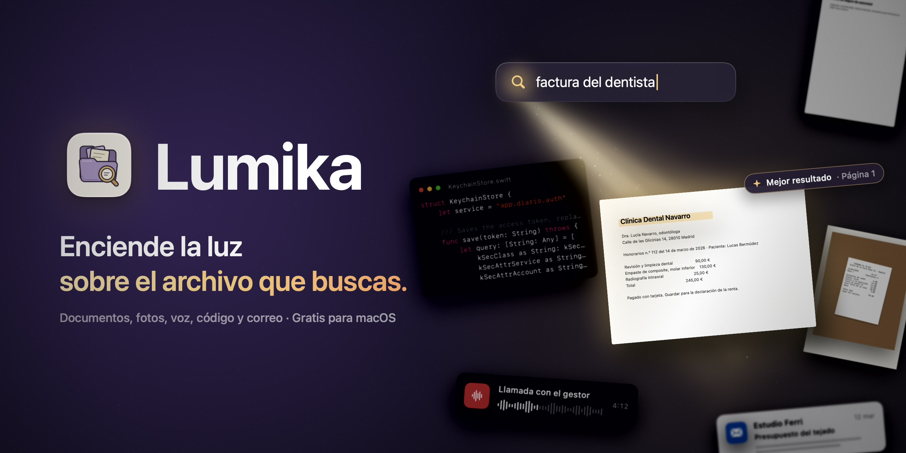
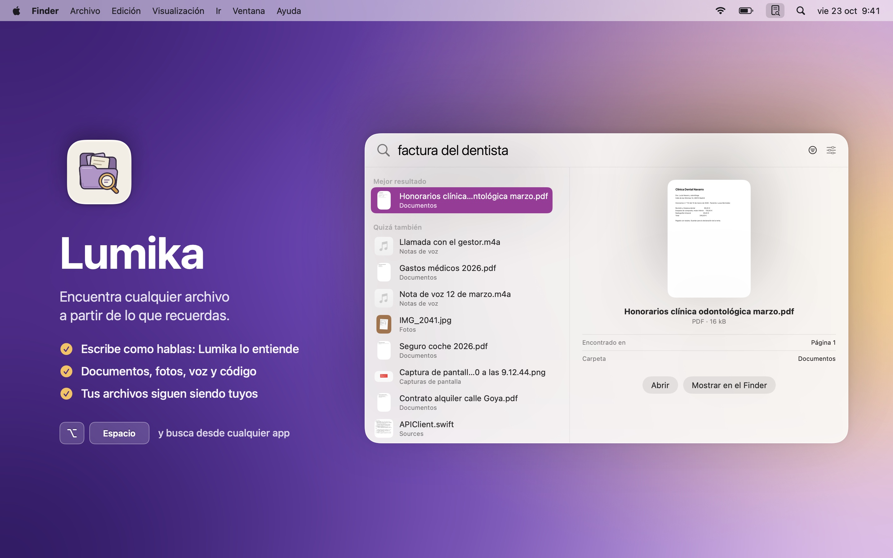
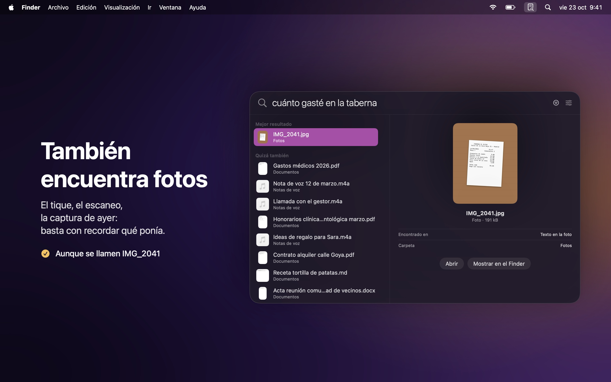
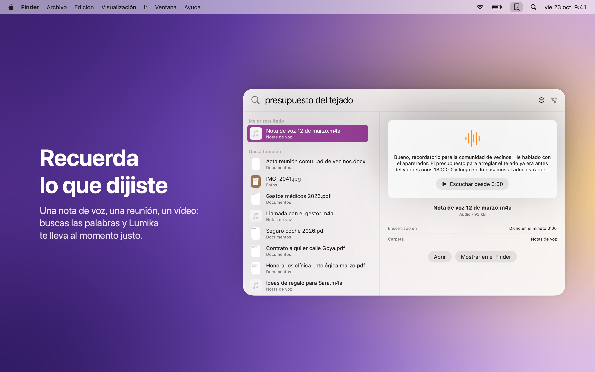
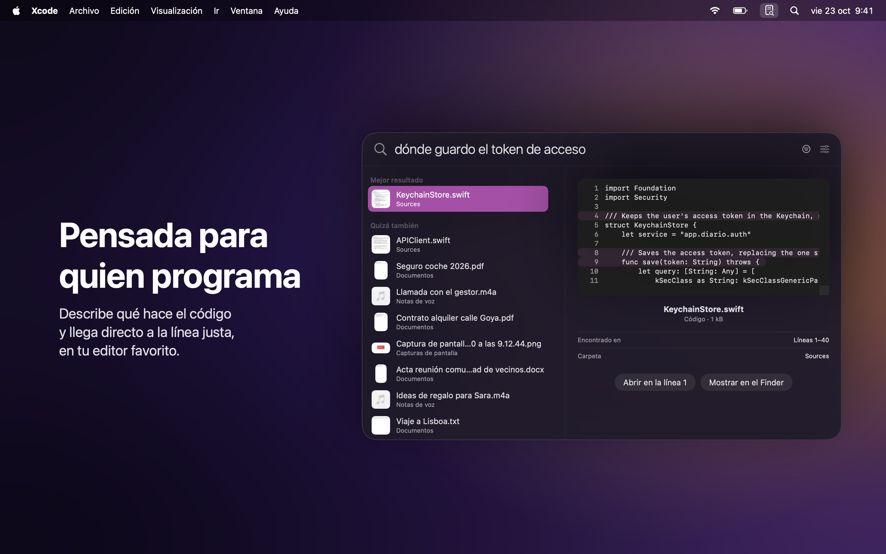
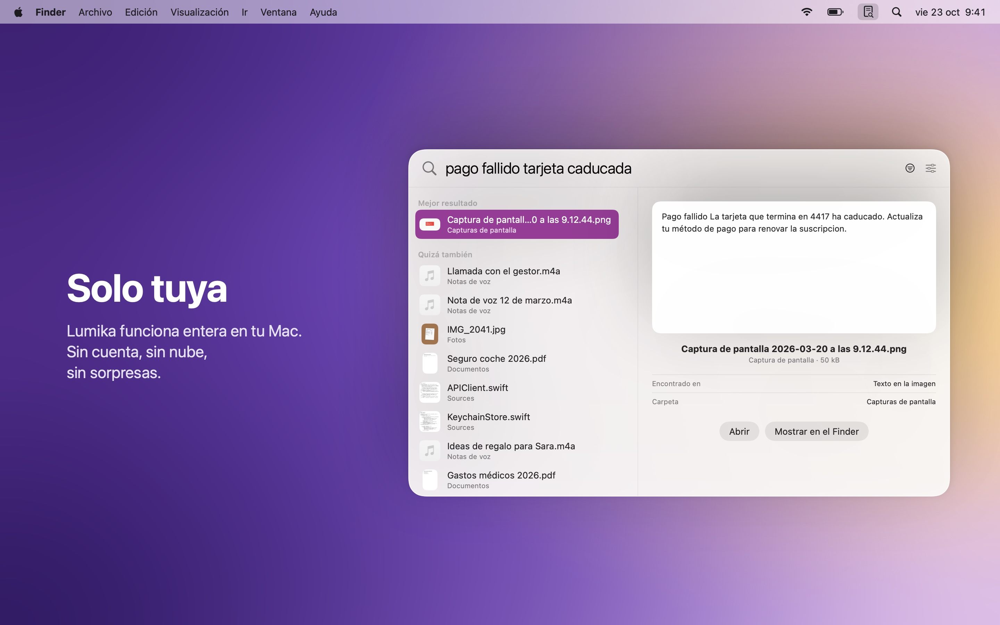

  

<h1 align="center">Lumika</h1>

  Encuentra cualquier archivo en tu Mac a partir de lo que recuerdas. 
  Documentos, fotos, notas de voz y código, en un instante.

  <a href="README.md">English</a> · <a href="README.it.md">Italiano</a> · <a href="README.fr.md">Français</a> · <b>Español</b>

  <a href="https://github.com/DevDreamer99/Lumika-Releases/releases/latest"><b>Descargar la última versión</b></a>
  &nbsp;·&nbsp; macOS 27 o posterior &nbsp;·&nbsp; Apple silicon &nbsp;·&nbsp; Gratis

  

---

No hace falta recordar cómo se llama un archivo ni dónde lo guardaste. Escribe lo que te venga a la cabeza, como lo dirías en voz alta: *"factura del dentista"*, *"cuánto gasté en la taberna"*, *"dónde guardo el token de acceso"*. Lumika entiende lo que quieres decir y te lo muestra, ya sea un documento, una foto, una nota de voz o una línea de código.

Pulsa **Opción Espacio** desde cualquier app y busca. Todo se queda en tu Mac.

  

## Qué hace

- **Entiende lo que buscas**: encuentra los "honorarios de la clínica odontológica" aunque escribas "factura del dentista". Las palabras pueden cambiar, el significado no.
- **También encuentra fotos**: tiques, escaneos y capturas de pantalla se encuentran por lo que pone en ellos, aunque se llamen IMG_2041.
- **Recuerda lo que dijiste**: notas de voz, reuniones y vídeos se buscan por las palabras dichas, y Lumika te lleva al momento justo.
- **Pensada para quien programa**: describe qué hace el código y llega a la línea justa, abierta en tu editor favorito (Xcode, VS Code, Cursor, Zed).
- **También en el correo**: los mensajes de Mail de Apple y sus adjuntos se encuentran por lo que dicen, y se abren en Mail con un clic. Tú eliges cuentas y buzones.
- **Lista enseguida**: en cuanto eliges las carpetas, los archivos ya se encuentran por su nombre; el contenido llega en pocos minutos, mientras trabajas.
- **Siempre al día**: los archivos que añades, cambias o mueves se encuentran solos, sin hacer nada.
- **También en iCloud**: los archivos que solo están en la nube se encuentran sin descargarlos.
- **También en discos externos**: desconectados, sus archivos siguen pudiéndose buscar; al volver a conectarlos, Lumika retoma sola.
- **Busca donde quieras**: en todo a la vez, o solo en una carpeta, un disco o el correo, con un clic.
- **Ajustes de verdad**: abre Lumika al iniciar sesión, elige el idioma y gestiona carpetas e índice en una ventana de Ajustes.
- **En cuatro idiomas**: español, inglés, italiano y francés, según el idioma de tu Mac.
- **Tú decides qué lee**: omite con un clic las carpetas que no te interesan. Las colecciones de datos, como cientos de imágenes con nombres generados por un programa, se omiten solas.
- **Cuida la batería**: en un portátil lee los archivos nuevos cuando conectas el cargador, y mientras tanto buscas como siempre.

<table>
  <tr>
    <td></td>
    <td></td>
  </tr>
  <tr>
    <td></td>
    <td></td>
  </tr>
</table>

## Instalación

1. Descarga el `.dmg` desde la [última versión](https://github.com/DevDreamer99/Lumika-Releases/releases/latest).
2. Ábrelo y arrastra **Lumika** a **Aplicaciones**.
3. Abre Lumika: vive en la barra de menús, arriba a la derecha. Elige las carpetas donde buscar y listo.

La primera vez, Lumika descarga su modelo (865 MB, una sola vez). Después funciona sin internet.

Lumika consulta esta página una vez al día e instala las nuevas versiones con un clic, tras comprobar que están firmadas por el desarrollador y notarizadas por Apple. La comprobación se puede desactivar en los ajustes.

## Solo tuya

- **Todo en tu Mac**: sin cuenta, sin nube, sin datos recogidos. Las únicas conexiones son la descarga del modelo y la comprobación de actualizaciones.
- **Tus archivos se quedan donde están**: Lumika solo los lee. Nunca los cambia, los mueve ni los envía.
- **Las contraseñas siguen siendo privadas**: las claves y los archivos de contraseñas nunca se leen.
- **Tu correo sigue siendo tuyo**: Lumika solo lee el correo que Mail ya ha descargado, y solo después de que lo elijas. No se conecta a los servidores y no conoce tus contraseñas.
- **Firmada y notarizada por Apple**: macOS comprueba cada descarga.

## Requisitos

| Versión | macOS | Mac |
|---|---|---|
| 1.0.0 y posteriores | 27 o posterior | Apple silicon |

## Novedades

**1.3.4**
- Busca en un solo sitio: con el menú Dónde elige una carpeta, un disco externo o el correo, y los resultados llegan solo de ahí.

**1.3.3**
- Al encender el Mac, Lumika se queda en la barra de menús sin abrir los Ajustes, aunque busques solo en el correo.

**1.3.2**
- Más cuidadosa con la batería: en un portátil lee archivos y correos nuevos solo con el cargador, y busca como siempre. Con *Leer de todos modos* lee también con batería.

**1.3.1**
- Cada mensaje encontrado muestra su cuenta y su buzón, en los resultados y en la vista previa.
- Cuando todo está leído, la página Mail indica que el correo está al día, sin barra llena.

**1.3.0**
- Busca también en el correo: los mensajes de Mail de Apple y sus adjuntos, con un clic para abrirlos en Mail.
- Elige cuentas y buzones; un buzón desactivado se queda en el índice, oculto, y no se pierde nada.
- Una página Mail en los Ajustes con el avance de la lectura, para cada buzón y también para las carpetas.
- Nuevo icono en la barra de menús: clic para buscar, clic derecho para el menú.
- Corregido: la app podía tener ocupado un núcleo del procesador incluso en reposo.

**1.2.1**
- Más privacidad dentro de la app: el motor de búsqueda ya no contiene los nombres de las carpetas del Mac en el que se compiló.

**1.2.0**
- Una ventana de Ajustes de verdad, desde la barra de menús con ⌘, o desde el panel de búsqueda.
- Abrir Lumika al iniciar sesión y elegir el idioma de la app.

**1.1.0**
- Lumika ahora habla inglés, francés y español además de italiano, y sigue el idioma de tu Mac.
- Las notas de actualización también llegan en tu idioma.

**1.0.3**
- Discos externos y memorias USB: desconectados siguen pudiéndose buscar; al volver a conectarlos, Lumika retoma sola.
- Corrección importante: con el modelo recién descargado, la búsqueda por significado podía no arrancar.

**1.0.2**
- Omite las carpetas que no te interesan, desde el clic derecho o desde Carpetas e índice.
- Las colecciones de datos se omiten solas: el índice se mantiene limpio y rápido.
- Rutas de carpetas más cortas y legibles.

**1.0.1**
- En el primer arranque Lumika empieza vacía: no lee ninguna carpeta hasta que tú la eliges.

**1.0.0**
- Primera versión.

---

© 2026 Mattia Fossati

