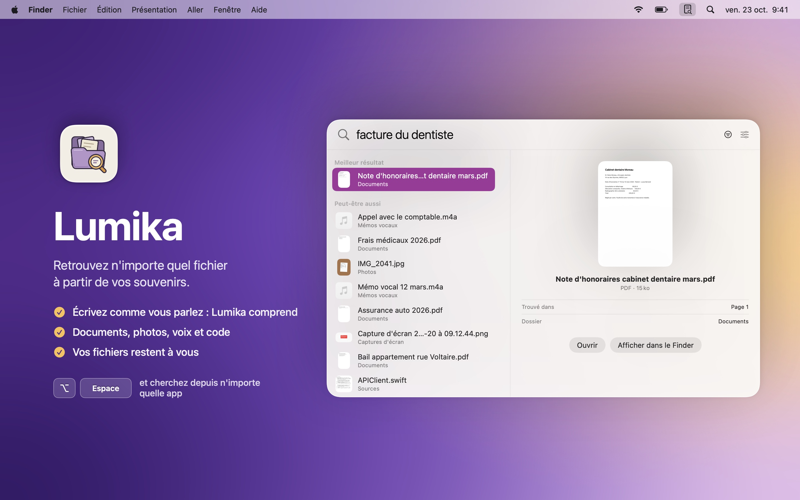
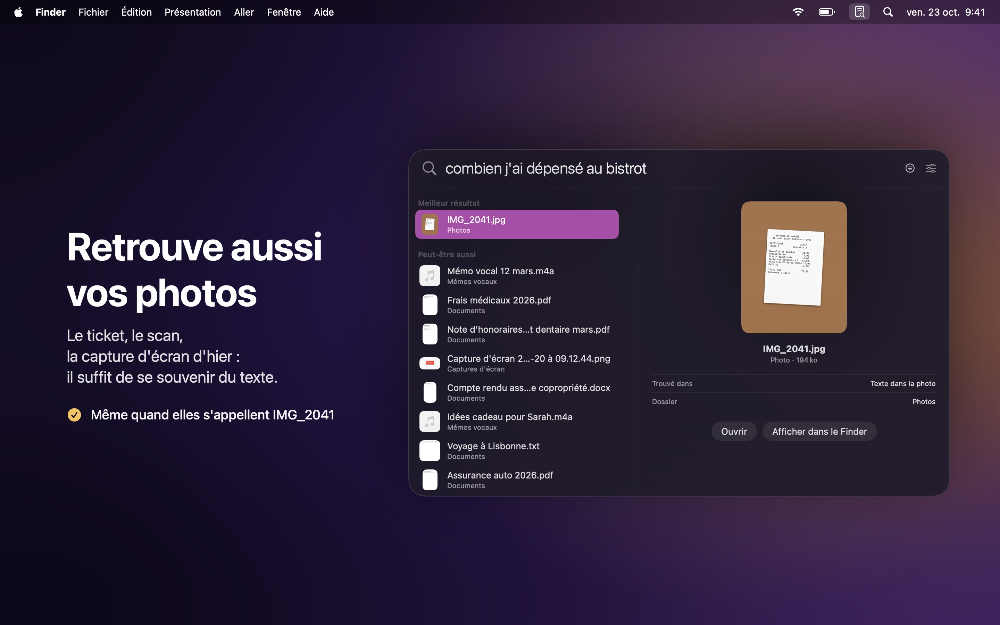
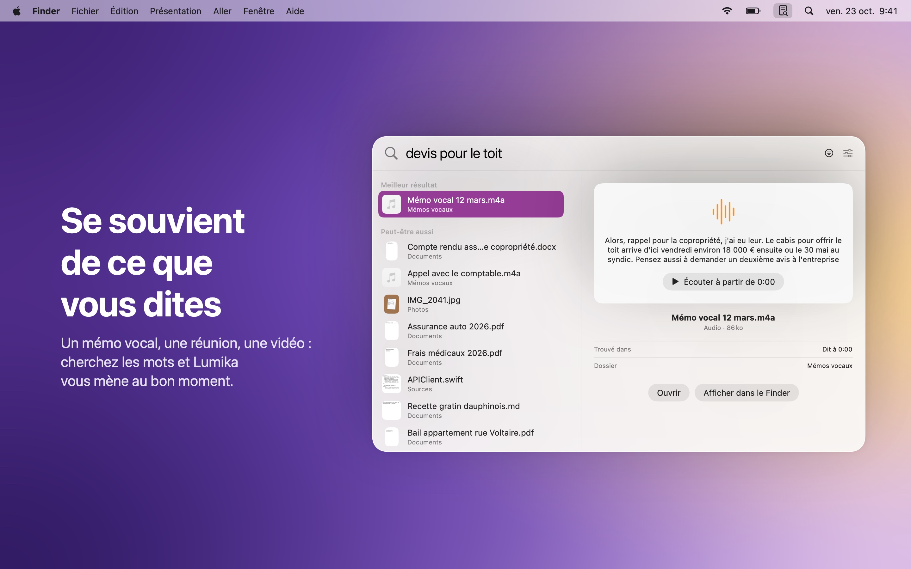
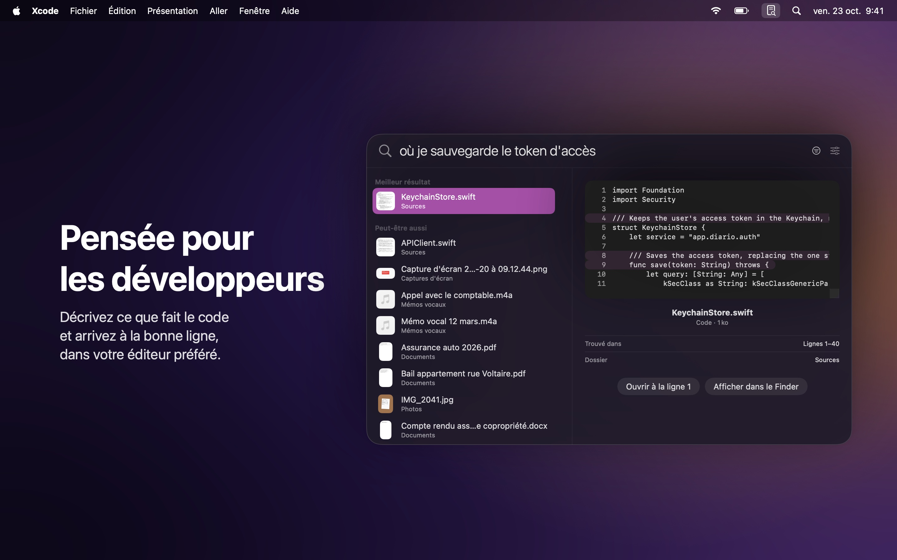
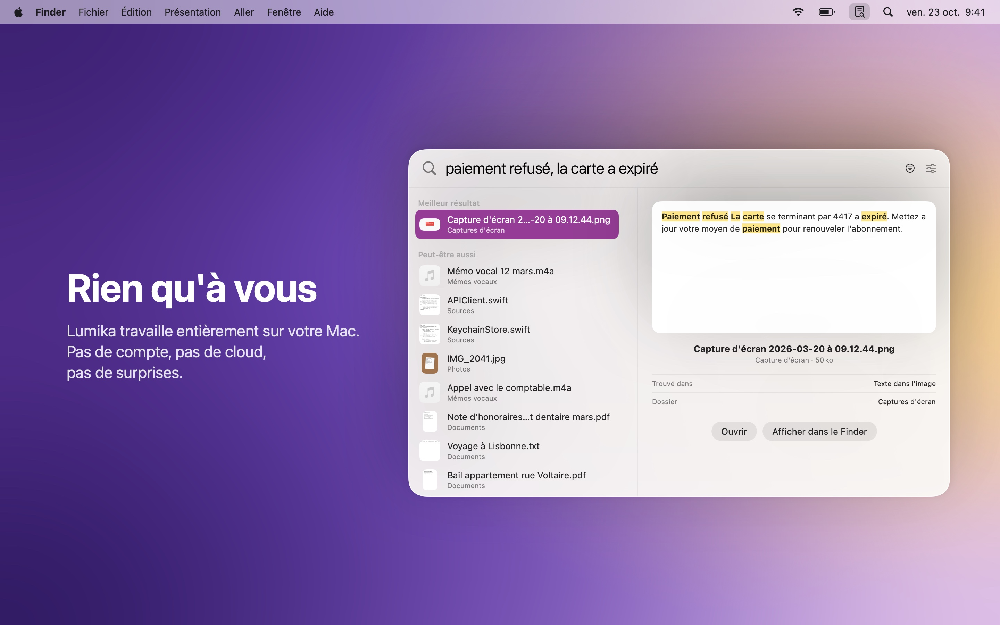

  

<h1 align="center">Lumika</h1>

  Retrouvez n'importe quel fichier sur votre Mac à partir de vos souvenirs. 
  Documents, photos, mémos vocaux et code, en un instant.

  <a href="README.md">English</a> · <a href="README.it.md">Italiano</a> · <b>Français</b> · <a href="README.es.md">Español</a>

  <a href="https://github.com/DevDreamer99/Lumika-Releases/releases/latest"><b>Télécharger la dernière version</b></a>
  &nbsp;·&nbsp; macOS 27 ou ultérieur &nbsp;·&nbsp; Apple silicon &nbsp;·&nbsp; Gratuit

  

---

Inutile de vous souvenir du nom d'un fichier ou de l'endroit où vous l'avez rangé. Écrivez ce qui vous vient à l'esprit, comme vous le diriez à voix haute : *« facture du dentiste »*, *« combien j'ai dépensé au bistrot »*, *« où je sauvegarde le token d'accès »*. Lumika comprend ce que vous voulez dire et vous le montre, qu'il s'agisse d'un document, d'une photo, d'un mémo vocal ou d'une ligne de code.

Appuyez sur **Option Espace** depuis n'importe quelle app et cherchez. Tout reste sur votre Mac.

## Ce qu'elle fait

- **Comprend ce que vous cherchez** : elle trouve la « note d'honoraires du cabinet dentaire » même si vous tapez « facture du dentiste ». Les mots peuvent changer, le sens non.
- **Retrouve aussi vos photos** : tickets, scans et captures d'écran se retrouvent par ce qui y est écrit, même quand ils s'appellent IMG_2041.
- **Se souvient de ce que vous dites** : mémos vocaux, réunions et vidéos se cherchent par les mots prononcés, et Lumika vous mène au bon moment.
- **Pensée pour les développeurs** : décrivez ce que fait le code et arrivez à la bonne ligne, ouverte dans votre éditeur préféré (Xcode, VS Code, Cursor, Zed).
- **Vos e-mails aussi** : les messages de Mail d'Apple et leurs pièces jointes se retrouvent par ce qu'ils disent, et s'ouvrent dans Mail en un clic. Vous choisissez les comptes et les boîtes.
- **Prête tout de suite** : dès que vous choisissez vos dossiers, les fichiers se retrouvent déjà par leur nom ; le contenu suit en quelques minutes, pendant que vous travaillez.
- **Toujours à jour** : les fichiers que vous ajoutez, modifiez ou déplacez se retrouvent tout seuls.
- **iCloud aussi** : les fichiers qui ne sont que dans le cloud se retrouvent sans les télécharger.
- **Disques externes aussi** : débranchés, leurs fichiers restent cherchables ; rebranchés, Lumika reprend toute seule.
- **De vrais réglages** : ouvrez Lumika à l'ouverture de session, choisissez la langue et gérez dossiers et index dans une fenêtre Réglages.
- **En quatre langues** : français, anglais, italien et espagnol, selon la langue de votre Mac.
- **Vous décidez de ce qu'elle lit** : ignorez d'un clic les dossiers qui ne vous intéressent pas. Les collections de données, comme des centaines d'images nommées par un programme, sont ignorées d'elles-mêmes.
- **Douce avec la batterie** : sur un portable, elle lit les nouveaux fichiers quand vous branchez le secteur, et vous cherchez comme toujours en attendant.

<table>
  <tr>
    <td></td>
    <td></td>
  </tr>
  <tr>
    <td></td>
    <td></td>
  </tr>
</table>

## Installation

1. Téléchargez le `.dmg` depuis la [dernière version](https://github.com/DevDreamer99/Lumika-Releases/releases/latest).
2. Ouvrez-le et faites glisser **Lumika** dans **Applications**.
3. Ouvrez Lumika : elle vit dans la barre des menus, en haut à droite. Choisissez les dossiers où chercher, et c'est parti.

La première fois, Lumika télécharge son modèle (865 Mo, une seule fois). Ensuite, elle fonctionne sans internet.

Lumika consulte cette page une fois par jour et installe les nouvelles versions en un clic, après avoir vérifié qu'elles sont signées par le développeur et notarisées par Apple. La vérification peut être désactivée dans les réglages.

## Rien qu'à vous

- **Tout sur votre Mac** : pas de compte, pas de cloud, aucune donnée collectée. Les seules requêtes réseau sont le téléchargement du modèle et la vérification des mises à jour.
- **Vos fichiers restent où ils sont** : Lumika se contente de les lire. Elle ne les modifie, ne les déplace et ne les envoie jamais.
- **Les mots de passe restent privés** : les clés et les fichiers de mots de passe ne sont jamais lus.
- **Vos e-mails restent à vous** : Lumika ne lit que les e-mails que Mail a déjà téléchargés, et seulement après que vous les avez choisis. Elle ne se connecte pas aux serveurs et ne connaît pas vos mots de passe.
- **Signée et notarisée par Apple** : macOS vérifie chaque téléchargement.

## Configuration requise

| Version | macOS | Mac |
|---|---|---|
| 1.0.0 et ultérieures | 27 ou ultérieur | Apple silicon |

## Nouveautés

**1.3.2**
- Plus douce avec la batterie : sur un portable, elle lit les nouveaux fichiers et e-mails seulement sur secteur, et cherche comme toujours. Avec *Lire quand même*, elle lit aussi sur batterie.

**1.3.1**
- Chaque e-mail trouvé indique son compte et sa boîte, dans les résultats et dans l'aperçu.
- Une fois tout lu, la page Mail indique que le courrier est à jour, sans barre pleine.

**1.3.0**
- Cherchez aussi dans vos e-mails : les messages de Mail d'Apple et leurs pièces jointes, à ouvrir dans Mail en un clic.
- Choisissez comptes et boîtes ; une boîte désactivée reste dans l'index, masquée, et rien n'est perdu.
- Une page Mail dans les Réglages avec l'avancement de la lecture, pour chaque boîte et aussi pour les dossiers.
- Nouvelle icône dans la barre des menus : un clic pour chercher, un clic droit pour le menu.
- Corrigé : l'app pouvait occuper un cœur du processeur même au repos.

**1.2.1**
- Plus de confidentialité dans l'app : le moteur de recherche ne contient plus les noms des dossiers du Mac sur lequel il a été compilé.

**1.2.0**
- Une vraie fenêtre Réglages, depuis la barre des menus avec ⌘, ou depuis le panneau de recherche.
- Ouvrir Lumika à l'ouverture de session, et choisir la langue de l'app.

**1.1.0**
- Lumika parle désormais anglais, français et espagnol en plus de l'italien, et suit la langue de votre Mac.
- Les notes de mise à jour arrivent aussi dans votre langue.

**1.0.3**
- Disques externes et clés USB : débranchés, ils restent cherchables ; rebranchés, Lumika reprend toute seule.
- Correction importante : avec un modèle tout juste téléchargé, la recherche par le sens pouvait ne pas démarrer.

**1.0.2**
- Ignorez les dossiers qui ne vous intéressent pas, depuis le clic droit ou depuis Dossiers et index.
- Les collections de données sont ignorées d'elles-mêmes : l'index reste propre et rapide.
- Chemins des dossiers plus courts et plus lisibles.

**1.0.1**
- Au premier lancement, Lumika démarre vide : elle ne lit aucun dossier tant que vous ne l'avez pas choisi.

**1.0.0**
- Première version.

---

© 2026 Mattia Fossati

