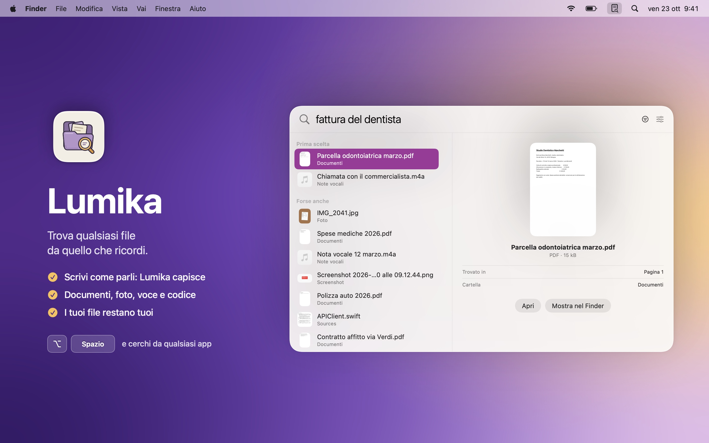
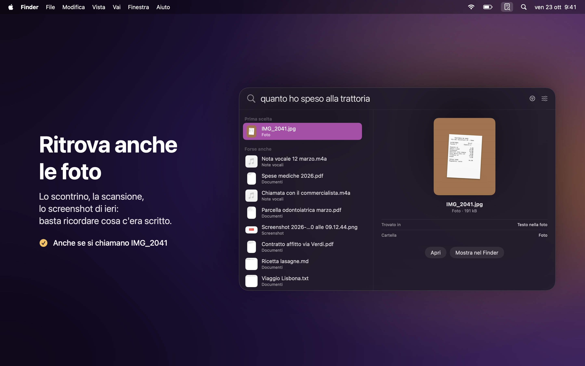
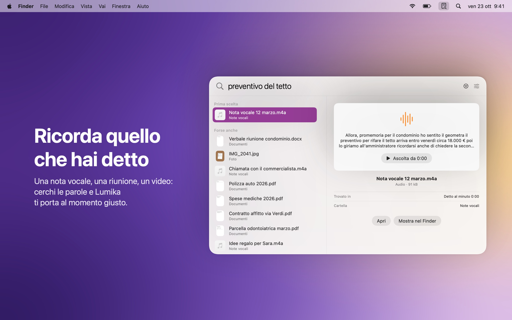
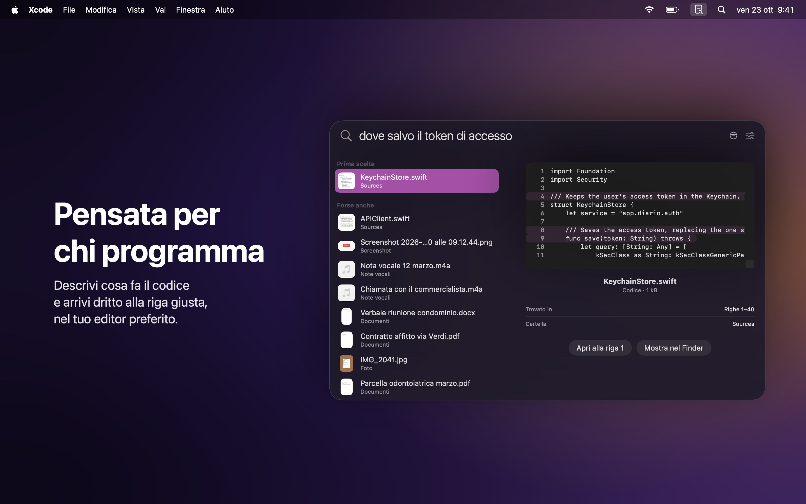
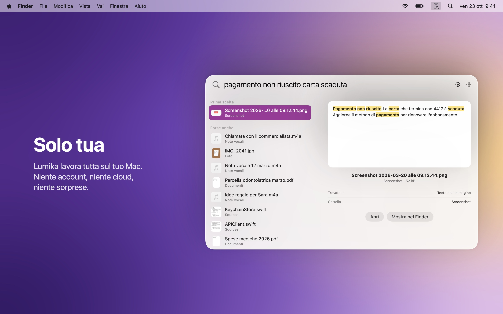

  

<h1 align="center">Lumika</h1>

  Trova qualsiasi file sul tuo Mac da quello che ricordi. 
  Documenti, foto, note vocali e codice, in un istante.

  <a href="README.md">English</a> · <b>Italiano</b> · <a href="README.fr.md">Français</a> · <a href="README.es.md">Español</a>

  <a href="https://github.com/DevDreamer99/Lumika-Releases/releases/latest"><b>Scarica l'ultima versione</b></a>
  &nbsp;·&nbsp; macOS 27 o successivo &nbsp;·&nbsp; Apple silicon &nbsp;·&nbsp; Gratis

  

---

Non serve ricordare come si chiama un file o dove l'hai salvato. Scrivi quello che ti viene in mente, come lo diresti a voce: *"la fattura del dentista"*, *"quanto ho speso alla trattoria"*, *"dove salvo il token di accesso"*. Lumika capisce cosa intendi e te lo mostra, che sia un documento, una foto, una nota vocale o una riga di codice.

Premi **Opzione Spazio** da qualsiasi app e cerca. Tutto resta sul tuo Mac.

## Cosa fa

- **Capisce quello che cerchi**: trova la "parcella odontoiatrica" anche se scrivi "fattura del dentista". Le parole possono essere diverse, il significato no.
- **Ritrova anche le foto**: scontrini, scansioni e screenshot si trovano da quello che c'è scritto sopra, anche se si chiamano IMG_2041.
- **Ricorda quello che hai detto**: note vocali, riunioni e video si cercano per le parole pronunciate, e Lumika ti porta al momento giusto.
- **Pensata per chi programma**: descrivi cosa fa il codice e arrivi alla riga giusta, aperta nel tuo editor preferito (Xcode, VS Code, Cursor, Zed).
- **Anche nella posta**: i messaggi di Mail di Apple e i loro allegati si trovano da quello che dicono, e si aprono in Mail con un clic. Scegli tu account e caselle.
- **Subito pronta**: appena scegli le cartelle, i file si trovano già dal nome; il contenuto arriva in pochi minuti, mentre lavori.
- **Sempre al passo**: i file che aggiungi, modifichi o sposti si trovano da soli, senza fare nulla.
- **Anche su iCloud**: i file che stanno solo nel cloud si trovano senza scaricarli.
- **Anche sui dischi esterni**: scollegati, i loro file restano cercabili; ricollegati, Lumika riprende da sola.
- **Impostazioni vere**: apri Lumika all'accesso, scegli la lingua e gestisci cartelle e indice in una finestra Impostazioni.
- **In quattro lingue**: italiano, inglese, francese e spagnolo, secondo la lingua del tuo Mac.
- **Decidi tu cosa leggere**: salta le cartelle che non ti interessano con un clic. E le raccolte di dati, come centinaia di immagini dai nomi generati da un programma, Lumika le salta da sola.

<table>
  <tr>
    <td></td>
    <td></td>
  </tr>
  <tr>
    <td></td>
    <td></td>
  </tr>
</table>

## Installazione

1. Scarica il `.dmg` dall'[ultima versione](https://github.com/DevDreamer99/Lumika-Releases/releases/latest).
2. Aprilo e trascina **Lumika** in **Applicazioni**.
3. Apri Lumika: vive nella barra dei menu, in alto a destra. Scegli le cartelle in cui cercare e il gioco è fatto.

La prima volta Lumika scarica il suo modello (865 MB, una volta sola). Poi lavora senza internet.

Lumika controlla questa pagina una volta al giorno e installa le nuove versioni con un clic, dopo aver verificato che siano firmate dallo sviluppatore e autenticate da Apple. Il controllo si può spegnere nelle impostazioni.

## Solo tua

- **Tutto sul tuo Mac**: nessun account, nessun cloud, nessun dato raccolto. Le uniche richieste in rete sono il download del modello e il controllo degli aggiornamenti.
- **I tuoi file restano dove sono**: Lumika li legge e basta. Non li modifica, non li sposta e non li invia.
- **Le password restano private**: chiavi e file di password non vengono mai letti.
- **La posta resta tua**: Lumika legge solo le mail che Mail ha già scaricato, e solo dopo che le hai scelte. Non si collega ai server e non conosce le tue password.
- **Firmata e autenticata da Apple**: macOS controlla ogni download.

## Requisiti

| Versione | macOS | Mac |
|---|---|---|
| 1.0.0 e successive | 27 o successivo | Apple silicon |

## Novità

**1.3.0**
- Cerca anche nella posta: i messaggi di Mail di Apple e i loro allegati, con un clic per aprirli in Mail.
- Scegli account e caselle; una casella spenta resta nell'indice, nascosta, e non perdi nulla.
- Una pagina Mail nelle Impostazioni con l'avanzamento della lettura, per ogni casella e anche per le cartelle.
- Nuova icona nella barra dei menu: clic per cercare, clic destro per il menu.
- Corretto: l'app poteva tenere occupato un core del processore anche a riposo.

**1.2.1**
- Più riservatezza dentro l'app: il motore di ricerca non contiene più i nomi delle cartelle del Mac su cui è stato compilato.

**1.2.0**
- Una vera finestra Impostazioni, dal menu con ⌘, o dal pannello di ricerca.
- Apri Lumika all'accesso e scegli la lingua dell'app.

**1.1.0**
- Lumika ora parla inglese, francese e spagnolo oltre all'italiano, e segue la lingua del tuo Mac.
- Anche le note degli aggiornamenti arrivano nella tua lingua.

**1.0.3**
- Dischi esterni e chiavette: scollegati restano cercabili, ricollegati Lumika riprende da sola.
- Correzione importante: con il modello appena scaricato la ricerca per significato poteva non partire.

**1.0.2**
- Salta le cartelle che non ti interessano, dal tasto destro o da Cartelle e indice.
- Le raccolte di dati vengono saltate da sole: l'indice resta pulito e veloce.
- Percorsi delle cartelle più corti e leggibili.

**1.0.1**
- Al primo avvio Lumika parte vuota: non legge nessuna cartella finché non sei tu a sceglierla.

**1.0.0**
- Prima versione.

---

© 2026 Mattia Fossati

