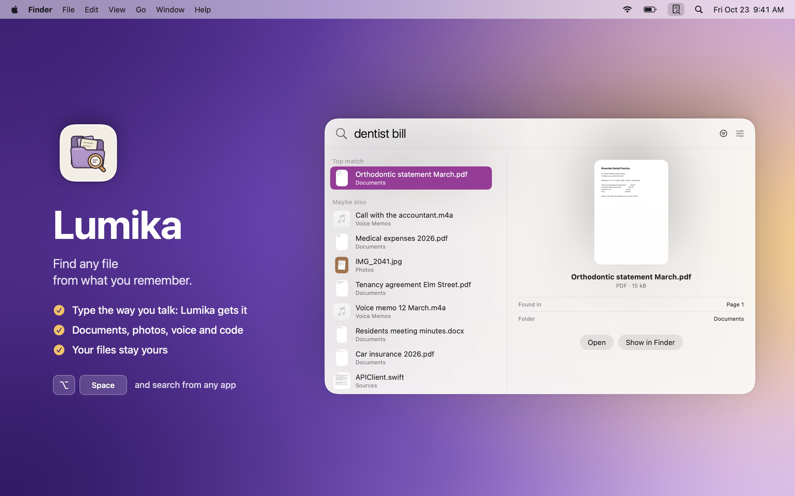
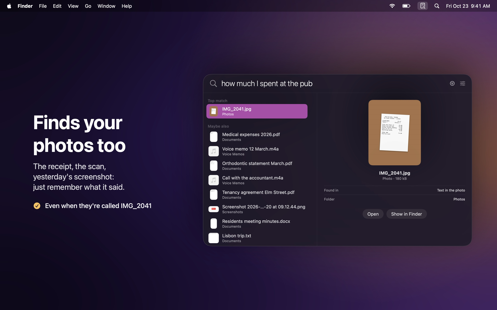
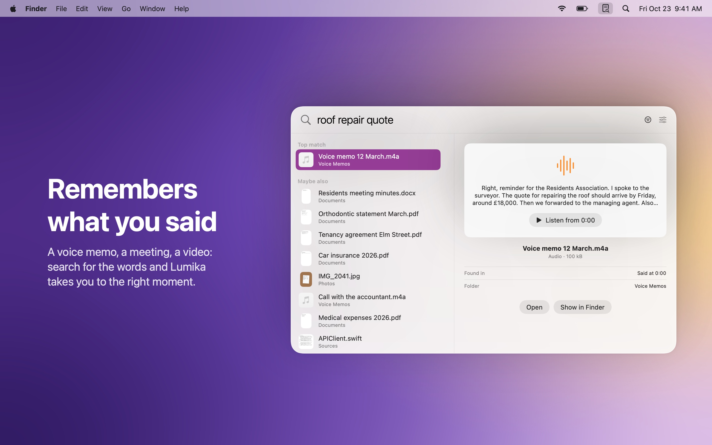
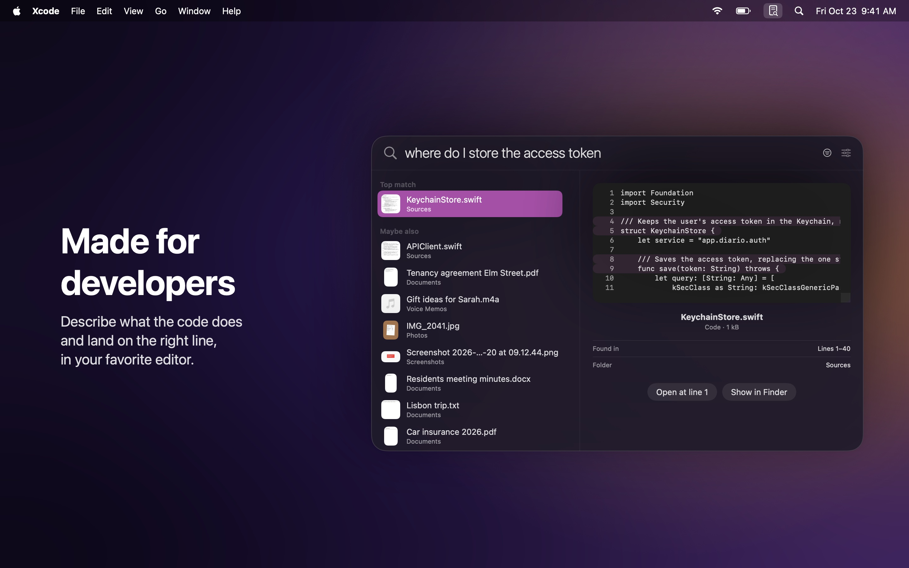
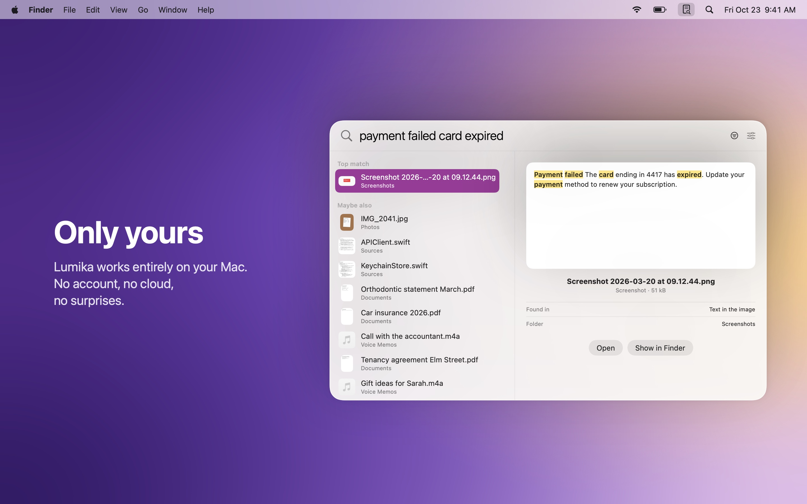

  

<h1 align="center">Lumika</h1>

  Find any file on your Mac from what you remember. 
  Documents, photos, voice memos and code, in an instant.

  <b>English</b> · <a href="README.it.md">Italiano</a> · <a href="README.fr.md">Français</a> · <a href="README.es.md">Español</a>

  <a href="https://github.com/DevDreamer99/Lumika-Releases/releases/latest"><b>Download the latest version</b></a>
  &nbsp;·&nbsp; macOS 27 or later &nbsp;·&nbsp; Apple silicon &nbsp;·&nbsp; Free

  

---

You don't need to remember what a file is called or where you saved it. Type whatever comes to mind, the way you'd say it out loud: *"dentist bill"*, *"how much I spent at the pub"*, *"where do I store the access token"*. Lumika understands what you mean and shows it to you, whether it's a document, a photo, a voice memo or a line of code.

Press **Option Space** from any app and search. Everything stays on your Mac.

## What it does

- **Understands what you're looking for**: finds the "orthodontic statement" even when you type "dentist bill". The words can differ, the meaning doesn't.
- **Finds your photos too**: receipts, scans and screenshots are found by what's written on them, even when they're called IMG_2041.
- **Remembers what you said**: voice memos, meetings and videos are searched by the words spoken, and Lumika takes you to the right moment.
- **Made for developers**: describe what the code does and land on the right line, opened in your favorite editor (Xcode, VS Code, Cursor, Zed).
- **Ready right away**: as soon as you choose your folders, files can be found by name; their content follows within minutes, while you work.
- **Always up to date**: files you add, change or move are found on their own, with nothing to do.
- **iCloud too**: files that live only in iCloud are found without downloading them.
- **External disks too**: unplugged, their files stay searchable; plugged back in, Lumika picks up on its own.
- **Settings of its own**: open Lumika at login, choose the language, and manage folders and index in a proper Settings window.
- **In four languages**: English, Italian, French and Spanish, following your Mac's language.
- **You decide what it reads**: skip the folders you don't care about with a click. Data collections, like hundreds of images named by a program, are skipped on their own.

<table>
  <tr>
    <td></td>
    <td></td>
  </tr>
  <tr>
    <td></td>
    <td></td>
  </tr>
</table>

## Install

1. Download the `.dmg` from the [latest release](https://github.com/DevDreamer99/Lumika-Releases/releases/latest).
2. Open it and drag **Lumika** into **Applications**.
3. Open Lumika: it lives in the menu bar, top right. Choose the folders to search in, and you're set.

The first time, Lumika downloads its model (865 MB, only once). After that it works without the internet.

Lumika checks this page once a day and installs new versions in one click, after checking that they're signed by the developer and notarized by Apple. You can turn the check off in the settings.

## Only yours

- **Everything on your Mac**: no account, no cloud, no data collected. The only network requests are the model download and the update check.
- **Your files stay where they are**: Lumika only reads them. It never changes, moves or sends them.
- **Passwords stay private**: keys and password files are never read.
- **Signed and notarized by Apple**: macOS checks every download.

## Requirements

| Version | macOS | Mac |
|---|---|---|
| 1.0.0 and later | 27 or later | Apple silicon |

## What's new

**1.2.1**
- More privacy inside the app: the search engine no longer carries the folder names of the Mac it was built on.

**1.2.0**
- A real Settings window, from the menu bar with ⌘, or from the search panel.
- Open Lumika at login, and choose the app's language.

**1.1.0**
- Lumika now speaks English, French and Spanish as well as Italian, and follows your Mac's language.
- Update notes come in your language too.

**1.0.3**
- External disks and USB sticks: unplugged they stay searchable, plugged back in Lumika picks up on its own.
- Important fix: with a freshly downloaded model, search by meaning could fail to start.

**1.0.2**
- Skip the folders you don't care about, from the right-click menu or from Folders and index.
- Data collections are skipped on their own: the index stays clean and fast.
- Shorter, easier-to-read folder paths.

**1.0.1**
- On first launch Lumika starts empty: it reads no folder until you choose one.

**1.0.0**
- First release.

---

© 2026 Mattia Fossati

