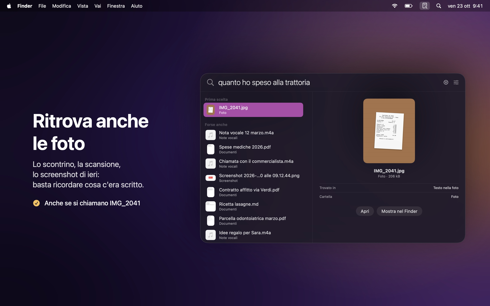
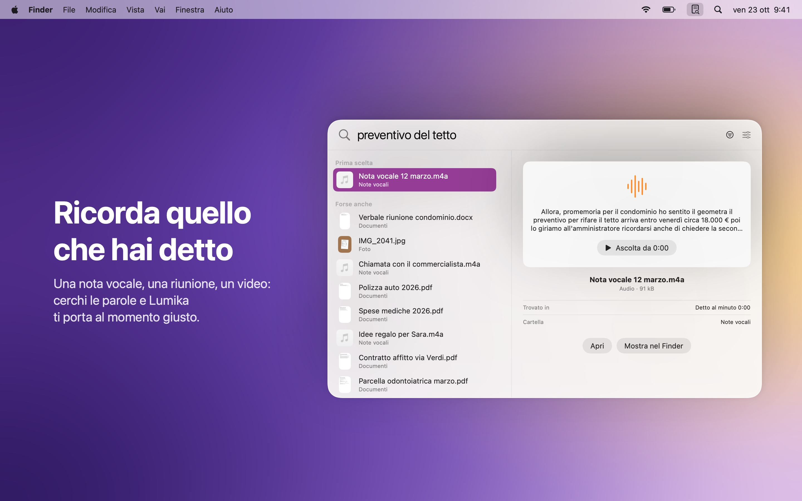
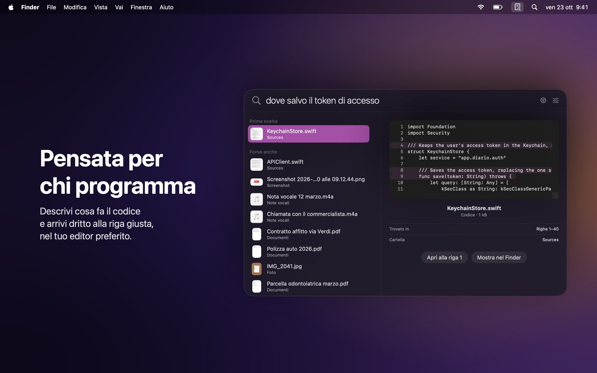
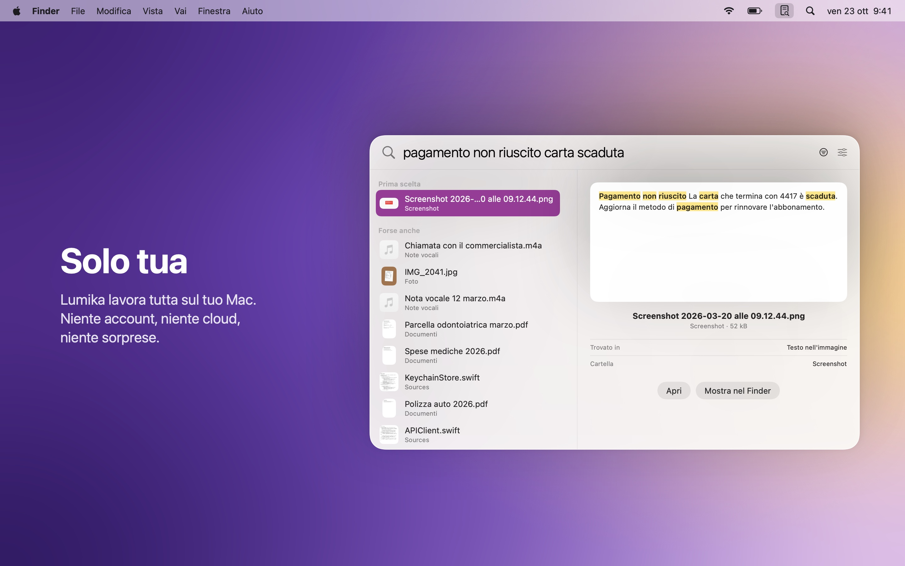

  

<h1 align="center">Lumika</h1>

  Trova qualsiasi file sul tuo Mac da quello che ricordi. 
  Documenti, foto, note vocali e codice, in un istante.

  <a href="https://github.com/DevDreamer99/Lumika-Releases/releases/latest"><b>Scarica l'ultima versione</b></a>
  &nbsp;·&nbsp; macOS 27 o successivo &nbsp;·&nbsp; Apple silicon &nbsp;·&nbsp; Gratis

  

---

Non serve ricordare come si chiama un file o dove l'hai salvato. Scrivi quello che ti viene in mente, come lo diresti a voce: *"la fattura del dentista"*, *"quanto ho speso alla trattoria"*, *"dove salvo il token di accesso"*. Lumika capisce cosa intendi e te lo mostra, che sia un documento, una foto, una nota vocale o una riga di codice.

Premi **Opzione Spazio** da qualsiasi app e cerca. Tutto resta sul tuo Mac.

## Cosa fa

- **Capisce quello che cerchi**: trova la "parcella odontoiatrica" anche se scrivi "fattura del dentista". Le parole possono essere diverse, il significato no.
- **Ritrova anche le foto**: scontrini, scansioni e screenshot si trovano da quello che c'è scritto sopra, anche se si chiamano IMG_2041.
- **Ricorda quello che hai detto**: note vocali, riunioni e video si cercano per le parole pronunciate, e Lumika ti porta al momento giusto.
- **Pensata per chi programma**: descrivi cosa fa il codice e arrivi alla riga giusta, aperta nel tuo editor preferito (Xcode, VS Code, Cursor, Zed).
- **Subito pronta**: appena scegli le cartelle, i file si trovano già dal nome; il contenuto arriva in pochi minuti, mentre lavori.
- **Sempre al passo**: i file che aggiungi, modifichi o sposti si trovano da soli, senza fare nulla.
- **Anche su iCloud**: i file che stanno solo nel cloud si trovano senza scaricarli.

<table>
  <tr>
    <td></td>
    <td></td>
  </tr>
  <tr>
    <td></td>
    <td></td>
  </tr>
</table>

## Installazione

1. Scarica il `.dmg` dall'[ultima versione](https://github.com/DevDreamer99/Lumika-Releases/releases/latest).
2. Aprilo e trascina **Lumika** in **Applicazioni**.
3. Apri Lumika: vive nella barra dei menu, in alto a destra. Scegli le cartelle in cui cercare e il gioco è fatto.

La prima volta Lumika scarica il suo modello (865 MB, una volta sola). Poi lavora senza internet.

Lumika controlla questa pagina una volta al giorno e installa le nuove versioni con un clic, dopo aver verificato che siano firmate dallo sviluppatore e autenticate da Apple. Il controllo si può spegnere nelle impostazioni.

## Solo tua

- **Tutto sul tuo Mac**: nessun account, nessun cloud, nessun dato raccolto. Le uniche richieste in rete sono il download del modello e il controllo degli aggiornamenti.
- **I tuoi file restano dove sono**: Lumika li legge e basta. Non li modifica, non li sposta e non li invia.
- **Le password restano private**: chiavi e file di password non vengono mai letti.
- **Firmata e autenticata da Apple**: macOS controlla ogni download.

## Requisiti

| Versione | macOS | Mac |
|---|---|---|
| 1.0.0 | 27 o successivo | Apple silicon |

## Novità

**1.0.0**
- Prima versione.

---

© 2026 Mattia Fossati

